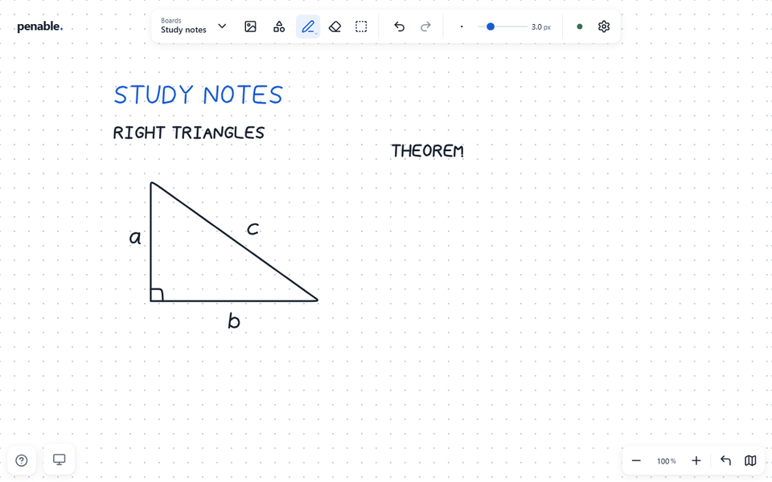
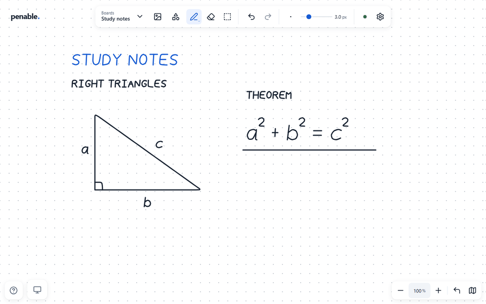
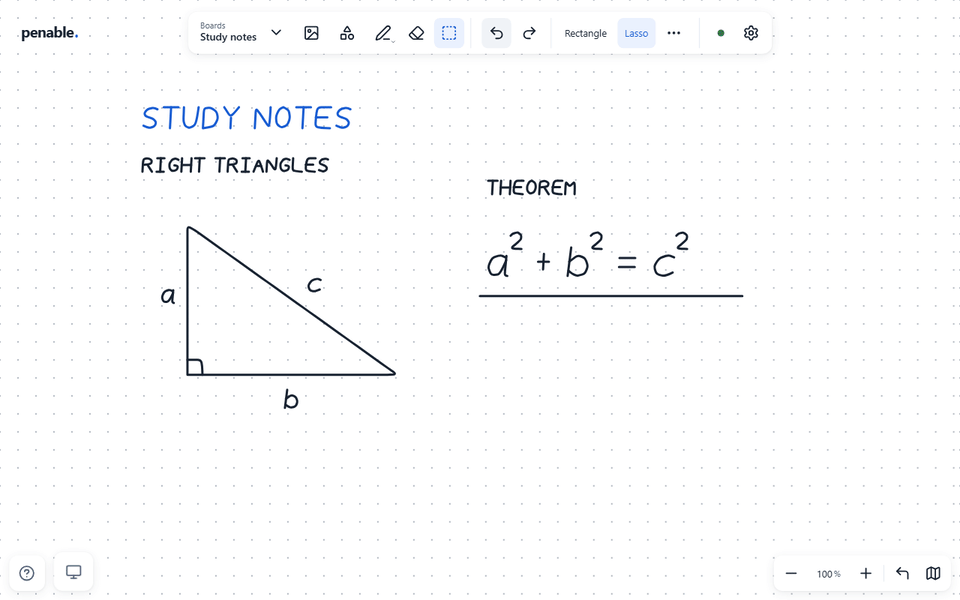
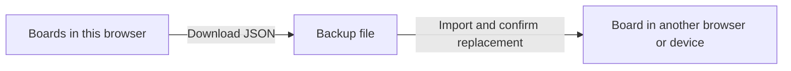

# penable

**A handwriting workspace for study notes, math, and explanations.**

Write formulas on a free board and rearrange a fragment with a lasso.

[**Open penable**](https://avatarsik6699.github.io/penable/) · [User guide](docs/GUIDE.md) · [Run locally](#run-locally)



[Still image](docs/media/writing.png). Actual app, authored notes, and scripted mouse input. [Recording details](docs/media/README.md).

## Made for handwriting

Choose a constant-width pen, pressure pen, or highlighter. Adjust stroke width and stabilization for the next stroke while existing notes keep their shape. Pan, zoom, and return to your last writing position.

The initial hardware check used **Windows 11, Wacom One, and Chrome**. Later pen features and other devices need their own hardware trial; the GIFs demonstrate editing workflows.

## Move the piece you need

Rectangle and lasso selection follow the painted area, including parts of crossing strokes. Keep the selection's empty margins, move the fragment, resize or rotate it, then undo the action.



[Still image](docs/media/fragment-editing.png).

## Reuse mathematical guides

Place editable number lines, XY axes, and trigonometric circles beside your handwriting. Switch between named boards using a searchable library with distinct colored covers.



[Still image](docs/media/math-boards.png).

## penable and Excalidraw

penable focuses on personal handwritten study notes. The free Excalidraw.com editor is a general-purpose whiteboard for diagrams and shared sketching. Choose by the work you want to do:

| Workflow | penable | Free Excalidraw.com |
|---|---|---|
| Writing and editing | Configurable stabilization; exact rectangle/lasso editing of stroke fragments | Free-draw, shapes, eraser, and image tools |
| Reusable diagrams | Built-in number lines, XY axes, and trig circles | Reusable shape libraries |
| Local work | Browser-local boards, JSON backups, prepared offline app | Local-first autosave, JSON export, offline support |
| Working together | Personal boards; sharing through exported files | Live collaboration and end-to-end encryption |

Excalidraw also draws freehand and works offline. [Excalidraw's feature list](https://github.com/excalidraw/excalidraw#features) documents its tools and hosted editor.

For Windows, [OneNote](https://www.microsoft.com/en-us/microsoft-365/onenote/digital-note-taking-app) combines ink with broader note organization and cross-device access. [Xournal++](https://xournalpp.github.io/) supports pressure-sensitive drawing tablets on Windows and [PDF annotation](https://xournalpp.github.io/guide/pdfs/). penable offers an account-free browser workspace centered on handwriting and fragment editing.

## Available and planned

**Checked:** available in the repository build. **Unchecked:** planned and cannot be used yet.

- [x] Pen, pressure pen, highlighter, and adjustable stabilization
- [x] Exact fragment selection, transforms, and undo/redo
- [x] Mathematical guides, PNG/JPEG insertion, and PNG export
- [x] Light, dark and system themes with adaptive handwriting colors
- [x] Named boards, local autosave, and editable JSON backups
- [x] Prepared offline use and automatic English/Russian interface selection
- [ ] PDF import, annotation, and export
- [ ] Partial-stroke eraser
- [ ] Optional cloud synchronization
- [ ] Handwriting recognition (OCR)

The public demo follows the separately released GitHub Pages revision. A local ship does not update it.

## Keep a copy of your notes

Notes stay in this browser profile. Clearing site data can delete them. Download JSON copies of important boards; installation and offline caching do not create a backup.



For offline use, open **App and offline** and wait for **Ready to work offline** after the first online load. Language settings are under **Board settings → View → Language**. The [guide](docs/GUIDE.md) covers controls, restore steps, and device checks.

## Run locally

Requires Node.js 22.12+ (22.x), 24.x, or 26+:

```bash
npm ci
npm run dev
```

Open **http://localhost:5173**. See [STACK](docs/STACK.md) for checks and delivery, [FRONTEND](docs/FRONTEND.md) for architecture, and [SPEC](docs/SPEC.md) for product contracts.
